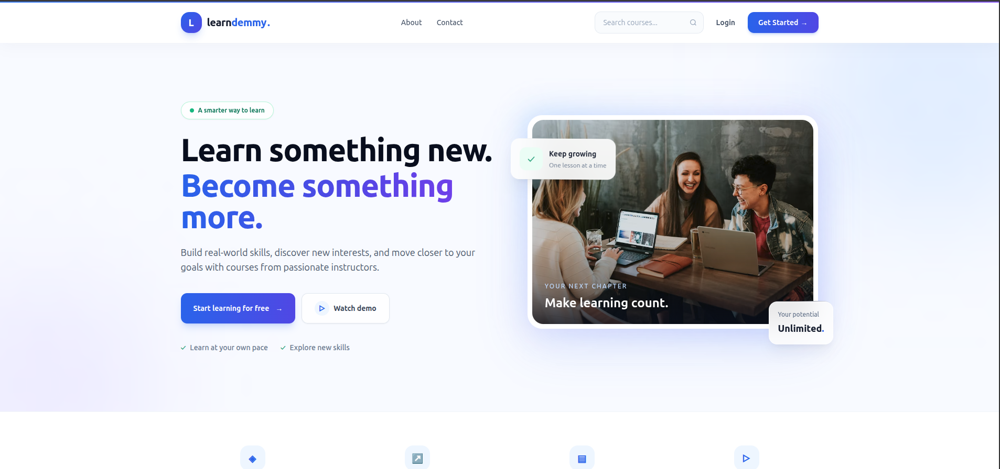
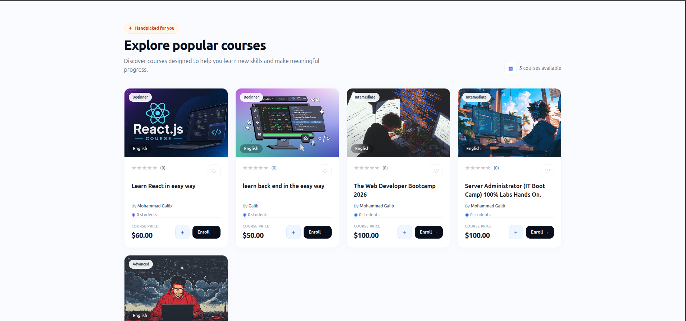
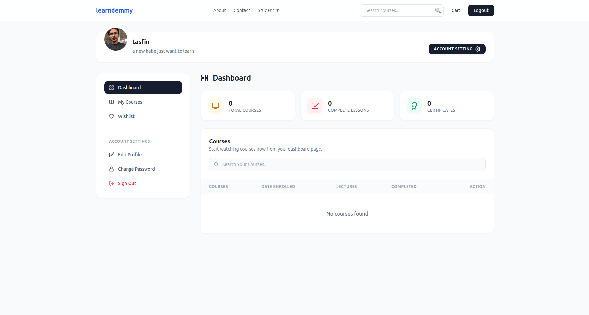
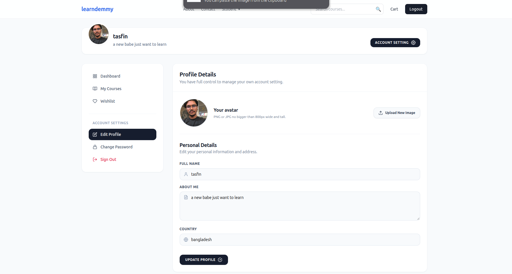
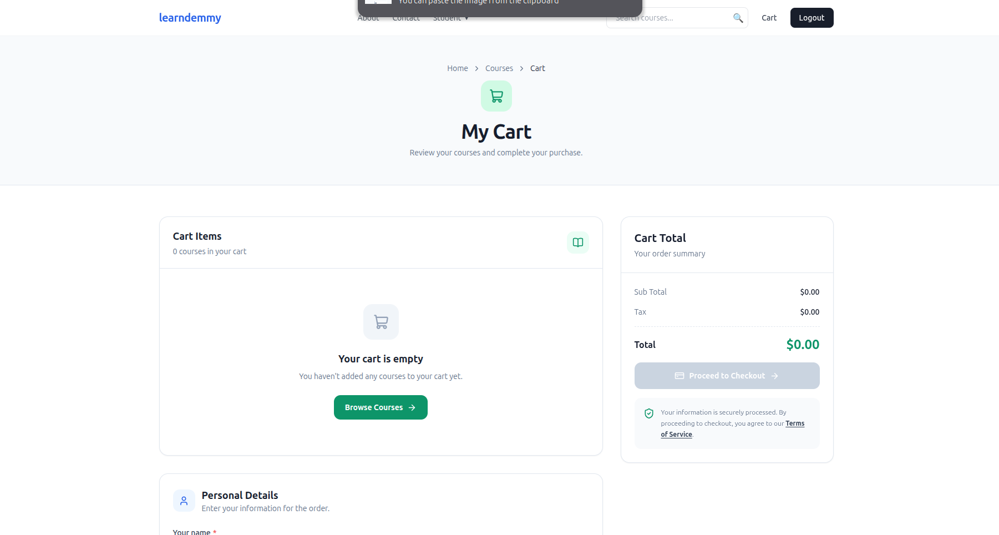

# Online Learning Managment System - LearnDemmy 

A full-stack online learning platform inspired by Udemy, designed to connect students and instructors through online courses and structured learning experiences.

## currently in development 

## OverView

This project aims to provide a platform where students can discover courses, enroll in learning programs, and access educational content, while instructors can create and manage their courses.

The application is being developed with a focus on backend engineering, REST API design, database relationships, authentication, and role-based access control.

## Tech Stack 
## Backend - python, Django, Django REST Framework 
## Front-end - React, javascript, Tailwind css 
## Database - PostgreSQL

### homepage 


### courses 


### Dashboard 


### profilesettings 


### cart 


## Project Structure

The project is organized into separate backend and frontend applications.

```LearnDemmy/
├── backend/
│   ├── manage.py
│   ├── requirements.txt
│   └── ...
├── frontend/
│   ├── package.json
│   └── ...
├── .gitignore
├── .env.example
└── README.md
```

### Features 
- User registration and authentication
- Role-based access for students, instructors, and administrators
- Course creation and management
- Course browsing and detail pages
- Student course enrollment
- Lessons and learning content
- Student learning progress tracking
- REST API integration between the frontend and backend
- Responsive user interface